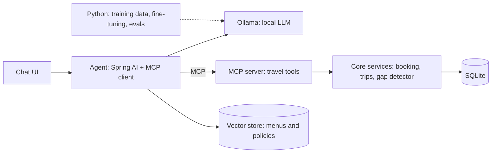

# Wayfinder

An agentic travel concierge that books trains, flights, hotels, restaurant tables and cabs
through MCP tools, and proactively offers cabs when a trip has gaps between bookings.
Runs fully local on open-source models, on synthetic data, at zero cost.

> **Status:** early development. See the roadmap below for what exists today.

## Why this exists

Most chatbot booking demos let the LLM do everything, which makes them unreliable: it guesses
availability and invents details. Wayfinder separates the concerns:

- **Deterministic services** own booking correctness (transactions, inventory, gap detection).
- **MCP** standardises how those capabilities are exposed as tools.
- **The LLM** handles understanding, planning and conversation, and its quality is measured
  by an automated eval suite, not by vibes.

## Planned features

- Search, book and cancel across five domains (trains, flights, hotels, restaurants, cabs)
- Multi-step requests, e.g. "train to Bengaluru Friday, hotel near the station, dinner Saturday"
- Itinerary-gap engine that proactively offers cabs between disconnected legs
- RAG over menus and policies, with cited answers
- Confirmation gate on every state-changing action
- Eval suite comparing models on tool-call accuracy and task success
- A fine-tuned open-source model compared against its base model

## Architecture



Java (Spring Boot) owns services, MCP and the agent. Python owns the ML work.
`core` has no dependency on any LLM library, so business rules are testable without a model.

## Roadmap

- [ ] Phase 0: project skeleton, config, design doc
- [ ] Phase 1: schema and seeded data generator
- [ ] Phase 2: booking services with transactions and tests
- [ ] Phase 3: trip model and gap detector
- [ ] Phase 4: MCP server
- [ ] Phase 5: agent loop with router (Ollama baseline)
- [ ] Phase 6: RAG for menus and policies
- [ ] Phase 7: conversation state and proactive cab offers
- [ ] Phase 8: eval suite and baseline results
- [ ] Phase 8.5: fine-tuning and re-evaluation
- [ ] Phase 9-10: UI, deployment, demo

## Tech stack

Java 21, Spring Boot, Spring AI, MCP, SQLite, Ollama, Python (fine-tuning and evals), Next.js.

## Getting started

Requirements: JDK 21, Maven, Git, [Ollama](https://ollama.com).

```bash
git clone https://github.com/<your-username>/wayfinder-concierge.git
cd wayfinder-concierge
ollama pull qwen3:8b
cd services && mvn -q test
```

More instructions will land as each phase does.

## Repository layout

```
services/   Java: core (domain), mcp-server, agent
ml/         Python: training data, fine-tuning, evals
web/        Next.js chat UI
DESIGN.md   goals, scope, decisions
```

## License

MIT